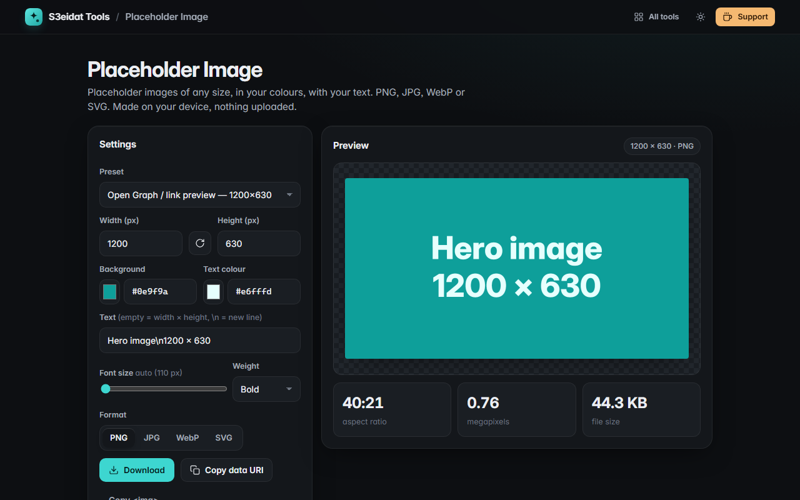

# Placeholder Image

> Generate placeholder images of any size. Free, private, and it runs entirely in your browser.

### ▶ [Open Placeholder Image](https://s3eidat.github.io/placeholder-image/)



## Features

- Any size from 1 to 8000 px, with a **swap** button for portrait/landscape
- **Presets** for web (Open Graph, hero, thumbnails), social (Instagram, stories, X and LinkedIn headers), IAB ad sizes and devices
- Background and text **colours** (picker or hex)
- Custom **text** (defaults to `width × height`), `\n` for a second line, auto-fitting or fixed **font size**, three weights
- Export as **PNG, JPG, WebP or SVG** (SVG is a tiny text file that scales perfectly)
- **Download**, copy as a **data URI**, or copy a ready `` tag
- Shows aspect ratio, megapixels and the real file size before you download
- Remembers your last settings

## Privacy

Images are drawn on your device with `<canvas>` (or written as SVG text). There is no server, no account, no analytics.
The page ships with a strict Content-Security-Policy (`connect-src 'self'`), so the browser
itself blocks any attempt to send data anywhere.

## Run it yourself

It's plain HTML, CSS and JavaScript with no build step:

```bash
git clone https://github.com/s3eidat/placeholder-image
cd placeholder-image
python -m http.server 8000
```

Then open http://localhost:8000.

## Support

If this saved you time, **[buy me a coffee ☕](https://s3eidat.github.io/coffee/)**. It keeps every tool free.

---

Part of **[S3eidat Tools](https://s3eidat.github.io/)**: 100+ free, private tools that run in your browser. MIT licensed.
